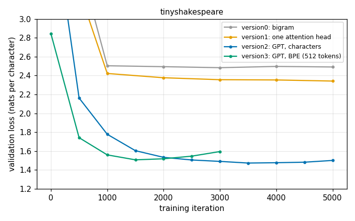
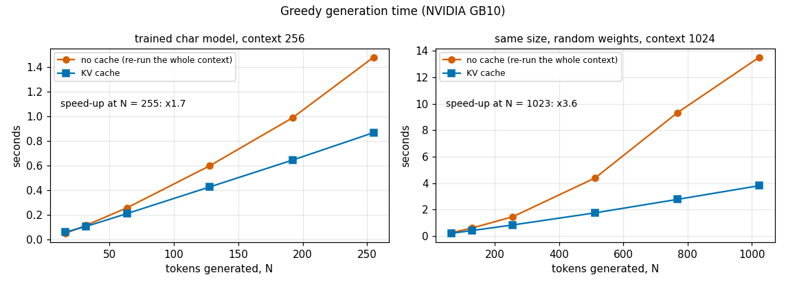
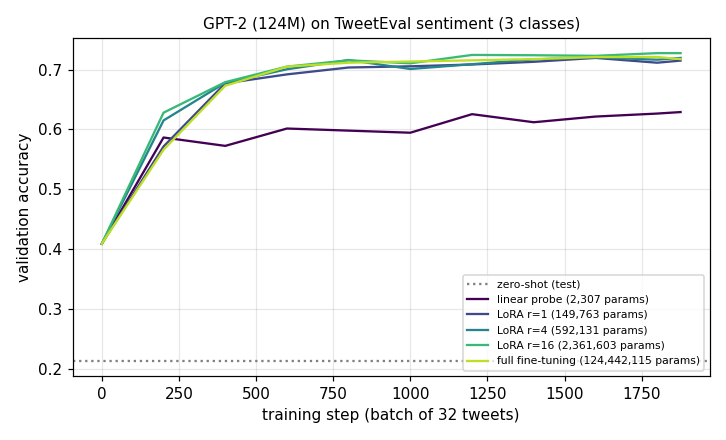
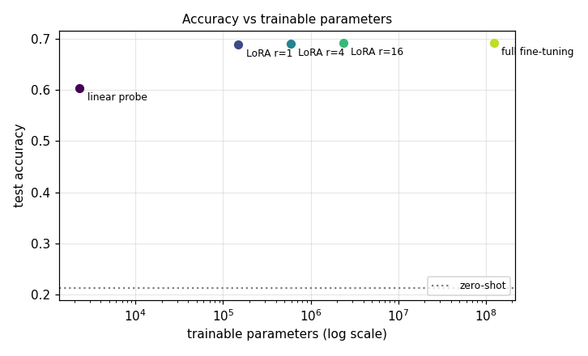

# GPT from Scratch

A step-by-step tutorial in PyTorch:
1. **Versions 0–3:** build a GPT (decoder-only transformer) from scratch, from a bigram model up to the full transformer, and train it on Shakespeare.
2. **Version 4:** make generation fast with a **KV cache**.
3. **Versions 5–6:** load OpenAI's pretrained **GPT-2** into the same from-scratch code, and fine-tune it for tweet sentiment with **LoRA** (Low-Rank Adaptation), written from scratch.

Every version adds one idea to the previous one.

The first part follows the spirit of Andrej Karpathy's lecture [Let's build GPT: from scratch, in code, spelled out](https://www.youtube.com/watch?v=kCc8FmEb1nY) and his [nanoGPT](https://github.com/karpathy/nanoGPT) (MIT licence). `gpt2.py` is adapted from nanoGPT.

---

## Theory

A dedicated lecture on language models is coming soon on https://parag1604.github.io/notes. Until then, attention, causal masking and the transformer block are covered in this [page](https://parag1604.github.io/notes/Machine-Learning/Applications-of-Neural-Networks#attention-and-transformers) (section "Attention and transformers").

## Python Environment Setup

Use python >= 3.10 and install the requirements:

```bash
pip install -r requirements.txt
```

- PyTorch: models and training. Install the hardware-accelerated build if possible; the code picks CUDA, then Apple MPS, then CPU.
- NumPy: data pipeline and the BPE tokenizer.
- Matplotlib: plots.
- Transformers (Hugging Face): **only for versions 5–6**. It downloads OpenAI's GPT-2 weights (about 0.5 GB, cached in `~/.cache/huggingface`) and the GPT-2 tokenizer. The model itself is our own code in `gpt2.py`. Versions 0–4 need only PyTorch.

## Data

Both datasets are small and ship with the repository, in `data/`.

- **`data/tinyshakespeare.txt`** (1.1 MB, 1,115,394 characters): the works of Shakespeare, from Karpathy's [char-rnn](https://github.com/karpathy/char-rnn/tree/master/data/tinyshakespeare). The first 90% is used for training and the last 10% for validation.
- **`data/tweet_sentiment/{train,val,test}.tsv`** (4.7 MB): the *sentiment* task of TweetEval[^tweeteval], a repackaging of SemEval-2017 Task 4, subtask A[^semeval].
  - Each line is `label<TAB>tweet`, with labels 0 = negative, 1 = neutral, 2 = positive. User names are anonymised as `@user`.
  - To keep the repository small, `train.tsv` is a random subset (seed 0) of 30,000 of the 45,615 training tweets. Validation (2,000 tweets) and test (12,284 tweets) are complete.
  - `prepare_tweets.py` downloads the original files from https://github.com/cardiffnlp/tweeteval and rebuilds these files. `python prepare_tweets.py --n_train 0` writes the full training set.
  - The tweets are subject to the terms of the original SemEval-2017 release; please cite both papers if you use them.

Model weights, the BPE cache and results are written to `checkpoints/`, which is not committed.

## Results at a glance

These runs were made on an NVIDIA GB10 that other jobs were also using, so the times are only indicative. All numbers below come from the runs described in each section.

| version | idea | result |
|---|---|---|
| 0 | bigram baseline | val loss 2.48 nats/char |
| 1 | one self-attention head | 2.34 |
| 2 | full GPT (multi-head attention, MLP, residuals, LayerNorm), 10.8M params | **1.47** |
| 3 | + BPE tokenizer (512 tokens) | 1.51 nats/char (it overfits sooner) |
| 4 | + KV cache | identical greedy output, **×3.6** faster at 1,023 tokens |
| 5 | pretrained GPT-2 (124M) in our code, zero-shot | test accuracy 0.214 |
| 6 | LoRA fine-tuning of GPT-2, rank 4, 0.47% of the weights | test accuracy **0.690** (full fine-tuning: 0.691) |

## Running

Every script has sensible defaults (`python versionX.py --help`). Versions 0–3 train when there is no checkpoint yet, or when `--train` is passed, and then print a sample. For a quick check that a version works, shrink it, for example:

```bash
python version2.py --max_iters 50 --eval_interval 25 --eval_iters 5 --n_layer 2 --n_embd 64 --n_head 4 --block_size 64 --ckpt checkpoints/tiny.pt
```

### 0. Bigram language model

```bash
python version0.py
```

Every character is a token; tinyshakespeare has 65 of them. Language modelling is next-token prediction: the target sequence is the input shifted by one position. The simplest neural language model is a 65 × 65 lookup table, in which row $i$ holds the logits of the character that follows character $i$. Sampling feeds each predicted character back in. A uniform guess costs ln 65 = 4.17 nats per character. The bigram model reaches **2.48** (5,000 iterations, under a minute), and it has learned letter pairs and nothing more:

```
Wantharun qur, vet?
F dilasoate awice my.
```

### 1. One head of self-attention

```bash
python version1.py
```

New: every position $t$ gathers information from positions $s \le t$ with a learned, data-dependent weighted average. It emits a query $q_t$, a key $k_t$ and a value $v_t$, and its output is

$$
\sum_{s} \mathrm{softmax}_s\big(q_t \cdot k_s/\sqrt{H}\big)\, v_s .
$$

- A lower-triangular **causal mask** sets the scores of future positions to $-\infty$, so the model cannot peek at the character it must predict.
- Dividing by $\sqrt{H}$, the head size, keeps the softmax from saturating at initialisation.
- Attention is order-blind, so learned **position embeddings** are added to the token embeddings.

With 32 characters of context and 22.7k parameters the validation loss is **2.34**.

### 2. The full GPT

```bash
python version2.py
```

New: the four ideas that turn one head into a transformer.
- **Multi-head attention:** 6 heads of size 64 run in parallel, computed with one batched matmul, and their outputs are concatenated and mixed.
- **A position-wise MLP** (384 → 1536 → 384, GELU): communication (attention) is followed by computation.
- **Residual connections:** each sub-layer adds to the stream, `x = x + attn(ln1(x))`, so gradients reach the first layers.
- **Pre-LayerNorm and dropout.**

The default model has 6 layers, 384 dimensions, 256 characters of context and **10.8M parameters**. It trains in 5,000 iterations, 46 minutes on the shared GPU. The validation loss bottoms out at **1.473** (iteration 3,500) and ends at 1.501, so it starts to overfit after about 3,500 iterations. Karpathy's lecture reports about 1.48 for the same setting. A sample:

```
LUCIO:
Prove a condition of my thumb'd such vassals, which I
Give me society, to my tribble unto thy faither's love
And hung upon her soul teat her;
```

`GPT` in `version2.py` is reused by versions 3 and 4.

### 3. A byte-pair-encoding tokenizer (optional)

```bash
python version3.py
```

New: only the tokenizer. BPE starts from the characters and repeatedly merges the most frequent adjacent pair into a new token until the vocabulary has 512 tokens (`", and "`, `"father"`, `"KING "`, …). It is written from scratch with NumPy. The text shrinks to 503k tokens, 2.22 characters per token, so the same 128-token context covers about 284 characters.

A loss per token is not comparable with a loss per character, so the script also reports nats per character. The BPE model reaches **1.51 nats/char** after 1,500 iterations, then overfits (1.59 at 3,000), because 1 MB of text is small for 512 token types. The other versions stay at character level. All the loss curves, in nats per character, are made by `python plot_losses.py`:



### 4. KV cache

```bash
python version4.py   # loads the version2 checkpoint
```

New: fast generation. Without a cache, every new token re-runs the model over the whole context, although causal attention guarantees that the keys and values of earlier positions never change. Generating $N$ tokens therefore costs $O(N^2)$ position-passes.

A **KV cache** stores every layer's keys and values, and generation runs in two phases:
- **prefill:** run the prompt once;
- **decode:** push only the newest token through the network, attend to the cached keys and values, and append its own.

The price is memory: $2 \times n_\text{layer} \times T \times C$ numbers per sequence, which is 1.2M numbers (4.7 MB in float32) here at $T=256$.

A subtlety with learned absolute position embeddings: when the cache is full, the oldest entry cannot simply be dropped, because every cached key was computed at its old position. The script rebuilds the cache from the most recent half window instead, and the uncached reference crops its context the same way.

The script checks correctness and then times both methods:
- **Correctness:** greedy decoding of 600 tokens, which includes a cache rebuild, gives **identical tokens** with and without the cache. The largest logit difference is 1.1e-5, which is float rounding.
- **Timing:** generation from a 1-token prompt, on the GB10.
  - For the trained model, the speed-up is ×1.7 at 255 tokens.
  - Because the speed does not depend on the weight values, the script also times a same-size model with random weights and a 1,024-token context. Without the cache the time grows quadratically (13.5 s for 1,023 tokens); with it the growth is linear (3.8 s), a **×3.6** speed-up.

  On a GPU, a model this small is probably limited by per-step overhead (kernel launches) rather than by arithmetic, so the gain only appears for long sequences.



### 5. Pretrained GPT-2, written from scratch

```bash
python version5.py
```

New: real pretraining. GPT-2 small (124M parameters, trained by OpenAI on about 40 GB of web text) is version2's GPT with a few details changed (see `gpt2.py`):
- a bias on the query/key/value projection;
- the tanh approximation of GELU;
- the output layer tied to the token embedding;
- 1,024 positions;
- a 50,257-token byte-level BPE, which is version3's algorithm applied to bytes.

`GPT2.from_pretrained('gpt2')` copies the official weights into our class, transposing the four matrices OpenAI stored as "Conv1D".

The script checks that our logits match Hugging Face's implementation (max difference **6e-5**) and samples a continuation:

```
The meaning of life is what we believe, but that is not the only way to live.
What is the purpose of life?
```

It also tries **zero-shot** tweet sentiment. It appends "The sentiment of this tweet is" to each tweet and compares the probabilities of " negative", " neutral" and " positive". This gives **0.214** test accuracy and 0.354 macro-recall: GPT-2 small is not instruction-tuned and answers "positive" for 11,924 of the 12,284 tweets. Version 6 has to do better.

### 6. Fine-tuning GPT-2 with LoRA

```bash
python version6.py   # about 20 minutes on the GPU; it downloads GPT-2 on first use
```

New: adapting the pretrained network to a labelled task (negative, neutral or positive tweet). The classifier reads the hidden state of the **last** token, which in a causal model is the only one that has seen the whole tweet, and applies a linear layer. Four ways of training it are compared on the same data, with the same head initialisation and 2 epochs each:

- **Linear probe:** GPT-2 is frozen and only the 768 × 3 head is trained.
- **LoRA, rank $r$** (`lora.py`; Hu et al., 2021[^lora]): every attention and MLP matrix $W$ (`c_attn`, `c_proj`, `c_fc` in all 12 blocks) stays frozen and gets a trainable low-rank update
  $$
  W x \;\to\; W x + \tfrac{\alpha}{r} B A x, \qquad A\in\mathbb{R}^{r\times d_\text{in}},\; B\in\mathbb{R}^{d_\text{out}\times r},
  $$
  with $\alpha = 2r$. **$A$ starts random and $B$ starts at zero.** The update is therefore 0 at the start, so training begins from the pretrained model, but $B$ receives a gradient proportional to $Ax$. If both were zero, neither would ever move.
- **Full fine-tuning:** every weight is trained. This is the reference.

The script verifies the LoRA mechanics:
- **At initialisation**, the LoRA model's outputs are identical to the frozen model's. The gradient of $A$ is exactly 0 and that of $B$ is not.
- **After training**, the update is merged into the weights, $W \leftarrow W + \frac{\alpha}{r}BA$. On the test set the logits change by at most **3.9e-5** (float rounding), and the predictions are **identical**. The merged model has no extra branch: float32 test-set inference takes 23.6 s instead of 39.2 s.

The validation set is evaluated every 200 steps, and the best step is evaluated once on the test set (12,284 tweets). TweetEval's official metric for this task is macro-averaged recall.

| method | trainable parameters | test accuracy | test macro-recall |
|---|---|---|---|
| zero-shot prompt (version 5) | 0 | 0.214 | 0.354 |
| linear probe | 2,307 (0.002%) | 0.604 | 0.598 |
| LoRA, r = 1 | 149,763 (0.12%) | 0.689 | 0.712 |
| LoRA, r = 4 | 592,131 (0.47%) | 0.690 | 0.713 |
| LoRA, r = 16 | 2,361,603 (1.9%) | **0.692** | **0.715** |
| full fine-tuning | 124,442,115 (100%) | 0.691 | 0.708 |

What the table shows:
- LoRA beats the frozen probe by **8.5 points** of accuracy (11 of macro-recall).
- LoRA matches full fine-tuning while training 0.1–2% of the weights; even rank 1 is enough here.
- An adapter is small: the rank-4 matrices are 2.4 MB in float32, against 500 MB for a full copy of GPT-2.

Learning rates: probe 3e-3, LoRA 5e-4, full fine-tuning 3e-5, with linear warm-up and decay, AdamW, batch 32, bfloat16 autocast. A single run per setting was made; differences of a few tenths of a point between the LoRA ranks and full fine-tuning are within run-to-run noise.





The full text samples of all versions are in [`static/samples.txt`](static/samples.txt).

## Files

| file | contents |
|---|---|
| `utils.py` | device, seeding, character tokenizer, random training windows, training loop |
| `version0.py` … `version4.py` | the steps above, at character level on Shakespeare |
| `gpt2.py` | GPT-2 from scratch, `from_pretrained`, sequence classifier |
| `lora.py` | `LoRALinear`, `apply_lora`, `merge_lora` |
| `version5.py`, `version6.py` | pretrained GPT-2: zero-shot, then probe / LoRA / full fine-tuning |
| `plot_losses.py` | the loss-curve figure for versions 0–3 |
| `prepare_tweets.py` | downloads TweetEval sentiment and writes `data/tweet_sentiment/` |

## References

- A. Karpathy, *Let's build GPT: from scratch, in code, spelled out* (2023), https://www.youtube.com/watch?v=kCc8FmEb1nY, and nanoGPT, https://github.com/karpathy/nanoGPT
- A. Vaswani et al., *Attention Is All You Need*, NeurIPS 2017, https://arxiv.org/abs/1706.03762
- A. Radford et al., *Language Models are Unsupervised Multitask Learners* (GPT-2), OpenAI 2019
- R. Sennrich, B. Haddow, A. Birch, *Neural Machine Translation of Rare Words with Subword Units* (BPE), ACL 2016, https://arxiv.org/abs/1508.07909

[^lora]: E. J. Hu et al., *LoRA: Low-Rank Adaptation of Large Language Models*, ICLR 2022, https://arxiv.org/abs/2106.09685
[^tweeteval]: F. Barbieri, J. Camacho-Collados, L. Espinosa-Anke, L. Neves, *TweetEval: Unified Benchmark and Comparative Evaluation for Tweet Classification*, Findings of EMNLP 2020, https://arxiv.org/abs/2010.12421 (data: https://github.com/cardiffnlp/tweeteval)
[^semeval]: S. Rosenthal, N. Farra, P. Nakov, *SemEval-2017 Task 4: Sentiment Analysis in Twitter*, SemEval 2017, https://aclanthology.org/S17-2088/
